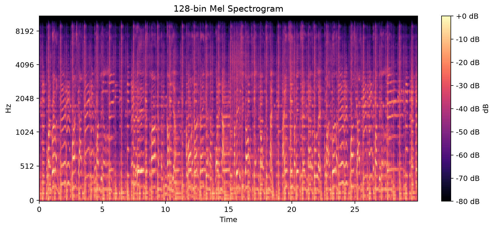
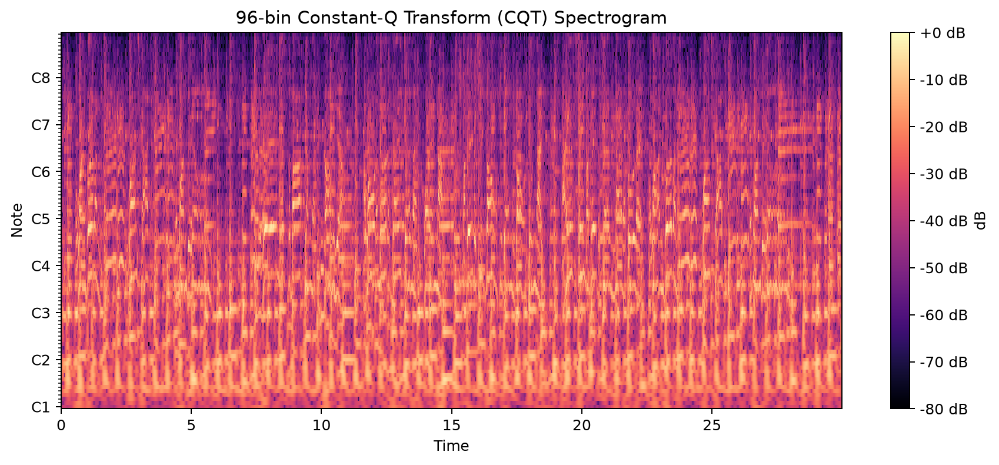
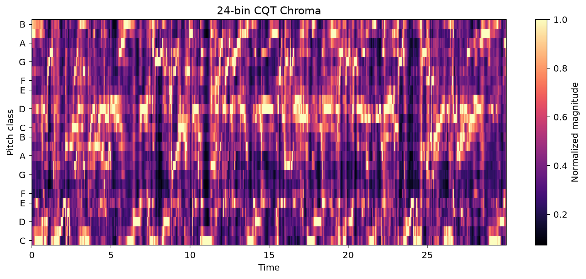
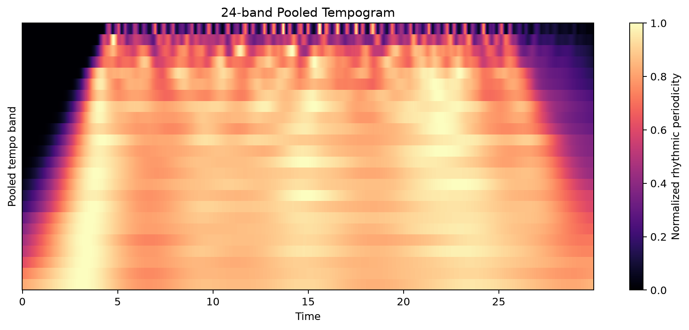
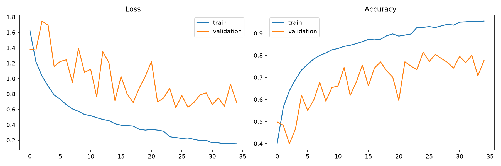
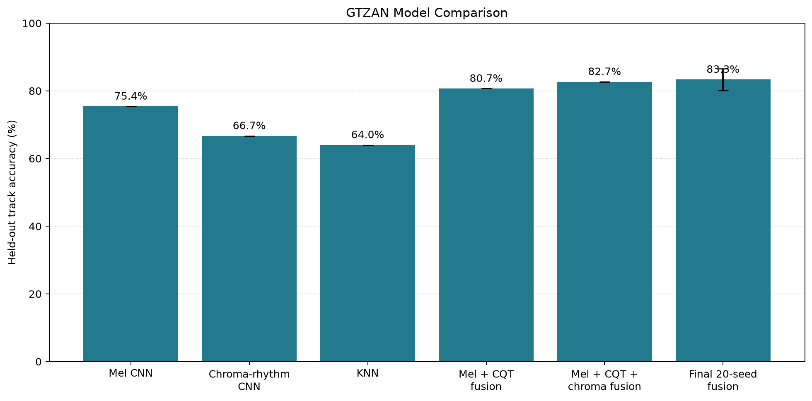

# First Progress Report

**Project:** Music Genre Classification Using Audio Feature Fusion

**Report date:** 24 September 2026

> This is a historical progress report. See the [core project scope and finalization record](core_project_lockdown.md) for the locked deliverable, result-artifact caveats, and current completion checks. In particular, the archived mel-CNN classification report's per-class support does not match its recorded track-level test split and must be reconciled before direct comparisons.

## a. Project Objectives

The project aims to build and evaluate a music genre classification system that predicts one of the ten GTZAN genres from an audio track. The main objectives are to:

1. Prepare reproducible audio datasets and prevent tracks from being shared between training, validation, and test sets.
2. Implement CNN classifiers using complementary audio representations: mel spectrograms, constant-Q transform (CQT) spectrograms, chroma, and rhythmic features.
3. Compare a deep-learning approach with a K-nearest neighbours (KNN) baseline.
4. Investigate late fusion of representation-specific CNN predictions to improve genre recognition.
5. Evaluate models using held-out, track-level accuracy, per-class precision/recall/F1-score, and confusion matrices.

## b. Proposed System Solution

The proposed system processes each audio track as follows:

1. Load up to 30 seconds of mono audio at 22,050 Hz.
2. Extract audio features. The current experiments use 128-bin mel spectrograms, 96-bin CQT spectrograms, 24-bin CQT chroma, and a 24-band pooled tempogram.
3. Divide each track into ten three-second excerpts. All excerpts from a track remain in the same dataset split.
4. Train separate CNNs for the different feature representations. Training uses augmentation, batch normalization, dropout, L2 regularization, learning-rate reduction, and early stopping.
5. Average the ten excerpt probabilities to obtain one prediction per track.
6. For the fusion experiment, combine mel, CQT, and chroma CNN probabilities using validation-selected weights. The current selected weights are mel $0.50$, CQT $0.20$, and chroma $0.30$.

### Feature Visualisations

The project uses a 128-bin mel spectrogram as its initial CNN input and additionally extracts a 96-bin CQT spectrogram, 24-bin CQT chroma, and a 24-band pooled tempogram for comparative experiments. Mel and CQT spectrograms show time-frequency energy at different frequency scales, chroma emphasizes pitch-class information, and the tempogram represents rhythmic periodicity. Figures 1-4 show these features for the representative GTZAN track `blues.00000.wav`.

The initial single mel-spectrogram CNN has therefore been extended into a comparative framework containing a KNN baseline, a chroma-rhythm CNN, and a three-representation late-fusion model. FMA Small is prepared as an additional dataset with a practical mapping to the GTZAN label structure, while Artist20 support has been implemented for artist classification experiments.

## c. Proposed Schedule and Progress

| Phase | Planned activity | Status and achievement |
| --- | --- | --- |
| 1 | Define the problem, datasets, and evaluation approach | Completed. The task is defined as ten-class music genre classification with track-level evaluation. |
| 2 | Prepare data handling and train/validation/test splitting | Completed. Stratified splits are made at track level, preventing excerpts from one song leaking into multiple splits. |
| 3 | Implement a mel-spectrogram CNN baseline | Completed. The held-out GTZAN result is $75.4\%$ accuracy using a 699/150/150 train/validation/test track split. |
| 4 | Implement alternative feature models and a conventional baseline | Completed. The chroma-rhythm CNN achieved $66.7\%$ and the KNN baseline achieved $64.0\%$ held-out accuracy on GTZAN. |
| 5 | Implement and tune late fusion | Completed. Two-model and three-model late-fusion experiments were evaluated on held-out GTZAN tracks. |
| 6 | Analyse results and refine the best model | In progress. A 20-seed final fusion evaluation, per-class reports, and confusion matrices are available. |
| 7 | Final testing, discussion, and report writing | In progress. The final comparison, limitations, and conclusions are being prepared. |

## d. Results of Model Iterations

All GTZAN experiments use the same track-level split: 699 training tracks, 150 validation tracks, and 150 held-out test tracks. For CNN-based experiments, probabilities from ten three-second excerpts are averaged to produce each track prediction. Accuracy and macro F1 are reported to show overall correctness and balanced performance across the ten genre classes.

The first iteration used a 128-bin mel-spectrogram CNN and achieved $75.4\%$ held-out test accuracy with a macro F1-score of $74.8\%$. It provided a strong deep-learning baseline: classical music achieved the highest F1-score ($91.5\%$), while country, disco, and rock remained difficult to identify. Figure 5 shows the training and validation metrics for this baseline. The second iteration used a chroma-rhythm CNN based on 24-bin CQT chroma and a pooled tempogram. Its accuracy was $66.7\%$ and macro F1-score was $65.7\%$. This indicates that harmonic and rhythmic information alone was less effective than mel spectrograms, although classical music was still recognised well ($90.9\%$ F1). Rock was the weakest class in this iteration, with an F1-score of $38.1\%$.

The third iteration established a conventional baseline using a distance-weighted KNN classifier with early-fused mel, CQT, and chroma statistics. It achieved $64.0\%$ accuracy and a macro F1-score of $63.4\%. This lower result suggests that the CNNs benefit from learning time-frequency patterns directly from the feature representations. As KNN does not train over epochs, a training curve is not applicable; Figure 6 instead shows its test-set confusion matrix. The fourth iteration used late fusion of mel and CQT CNNs, increasing accuracy to $80.7\%$ and macro F1 to $80.2\%$. Although this was a $5.3$ percentage-point improvement over the original mel-CNN, validation selected a mel weight of $1.0$ and a CQT weight of $0.0$, so it did not demonstrate a complementary CQT contribution.

The fifth iteration combined mel, CQT, and chroma CRNNs using three-way late fusion. It achieved $82.7\%$ accuracy and $82.6\%$ macro F1, improving on the original mel-CNN by $7.3$ percentage points. The validation-selected weights of mel $0.50$, CQT $0.20$, and chroma $0.30$ show that the three representations provided complementary information. Figure 7 compares the held-out accuracy achieved by the completed model iterations.

The final iteration evaluated three-model late fusion across 20 random seeds using fixed weights of mel $0.60$, CQT $0.30$, and chroma $0.10$. It achieved mean held-out accuracy of $83.3\% \pm 3.2\%$ and a macro F1-score of $83.2\%$. Individual runs ranged from $76.7\%$ to $88.0\%$, showing both the advantage of fusion and expected variation from the small dataset. Compared with the initial mel-CNN, the final fusion model improved mean accuracy by $7.9$ percentage points. Metal ($93.0\%$ F1) and classical ($93.6\%$ F1) were the most consistently recognised genres, while rock remained the most challenging ($64.8\%$ F1). Figures 8 and 9 show the aggregate training behaviour and confusion matrix for this final evaluation.

## e. Problems and Risks

1. **Dataset limitations:** GTZAN is relatively small and has known duplication and mislabelling concerns [1]. Results will be reported as benchmark results rather than a guarantee of real-world performance.
2. **Genre ambiguity:** Some genres share instrumentation and production characteristics. This is visible in the class-level results, particularly for country, disco, and rock in the mel-CNN experiment.
3. **FMA-to-GTZAN mapping:** FMA has a broader taxonomy than GTZAN, so mapping FMA labels to ten GTZAN classes is approximate and may introduce label noise.
4. **Computational cost:** Training several CNNs and testing fusion weights requires more time and GPU/CPU resources than a single model.
5. **Reproducibility:** Random seeds and fixed split procedures are used, but minor differences may still occur across hardware and software environments.

## f. Current Activities

Current work is focused on documenting and discussing the completed late-fusion evaluation, comparing it fairly with the mel-CNN, chroma-rhythm CNN, and KNN baseline, and reviewing confusion matrices to identify genre pairs that need improvement. The next implementation activities are to run the FMA Small and Artist20 experiments where the local datasets are available, document the full experimental configuration, and prepare the final results discussion.

## g. Proposed Improvement or Extension Area / New Algorithm

The current late-fusion system uses fixed weights for the mel, CQT, and chroma models. A useful extension would replace these fixed weights with an attention-based fusion network that learns representation weights for each track. This would allow the model to rely more heavily on the feature representation that is most informative for a particular musical style, rather than applying the same weights to every track.

The extension could also apply targeted augmentation and class-balanced sampling to the genres with the lowest F1-scores, particularly rock, country, and disco. Its performance would be evaluated on the same held-out track-level split and across multiple random seeds. The proposed method would be considered effective if it improves macro F1-score, reduces confusion among these difficult genres, and maintains or improves the current mean held-out accuracy of $83.3\%$.

## Dataset Citations

[1] G. Tzanetakis and P. Cook, "Musical Genre Classification of Audio Signals," *IEEE Transactions on Speech and Audio Processing*, vol. 10, no. 5, pp. 293-302, 2002. https://doi.org/10.1109/TSA.2002.800560

[2] M. Defferrard, K. Benzi, P. Vandergheynst, and X. Bresson, "FMA: A Dataset For Music Analysis," in *Proceedings of the 18th International Society for Music Information Retrieval Conference (ISMIR)*, 2017, pp. 1-8. https://arxiv.org/abs/1612.01840

[3] D. P. W. Ellis, "The Artist20 Dataset," LabROSA, Columbia University. https://labrosa.ee.columbia.edu/projects/artist20/ (accessed 24 September 2026).